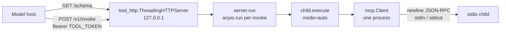

# function-over-sdk-stdio

| Field | Value |
|---|---|
| Document | tool-mcp-bridge top solution |
| Solution | **function-over-sdk-stdio** (brainstorm candidate S1) |
| Author | Evgeniy Chistyakov \<unhandled@exception.expert\> |
| Date | 2026-10-16 |
| Status | Reviewer consensus |
| Fallback | function-over-stdlib-stdio (S2), same HTTP contract, only if this dependency is rejected |
| Package | `tool-mcp-bridge` 1.0.0 |

This document records reviewer consensus on the named top solution function-over-sdk-stdio. `docs/design/review-round-2.md`: approve, open issues 0, date 2026-10-16.

## Overview

`tool-mcp-bridge` is a loopback HTTP process that publishes one client-side function, `mcp_call`, for a model host to register beside server-side tools. `GET /schema` returns that descriptor. `POST /v1/invoke` runs it. The process is the MCP host: `server_label` selects one configured server, and that server is a child process.

Today the child protocol is not MCP. `run()` in `src/tool_mcp_bridge/server.py` writes one private JSON object, `{"tool", "arguments"}`, and parses one stdout blob. A spec server that writes only newline-delimited JSON-RPC fails that path, and the echo fixture in `tests/test_tool.py` fails a spec client.

This design keeps the process, the function name, and the HTTP surface, and changes only the child session. Each stdio invoke or list entry becomes one short-lived `mcp.Client` over stdio, with the SDK's default era policy stated explicitly as `mode="auto"`. List returns `tools/list` (name, description, `inputSchema`) and does not return `command`. Invoke returns the MCP result on HTTP 200, including `isError: true` and a returned-but-not-completed `input_required` result. The first runtime dependency is `mcp>=2,<3`. The HTTP server stays the stdlib handler in `src/tool_http.py`.

## Background & Motivation

The acceptance bar in `TASK_SPECIFICATION.md` and `AGENTS.md` is already narrow: expose locally configured MCP servers as one client-side function on 127.0.0.1, with tests for list and stdio invoke. HTTP MCP is unimplemented. The package does not call a model.

What the tree does now:

- `src/tool_http.py` serves `ThreadingHTTPServer`. Default bind is `TOOL_HOST=127.0.0.1` and `TOOL_PORT=8090`. `GET /healthz` and `GET /health` return `{status, tool, mode: local}` with no auth. `GET /schema` is also unauthenticated. `POST /v1/invoke` and `POST /invoke` require `Authorization: Bearer <TOOL_TOKEN>` when the token is non-empty (default token string `local`). The body cap is 2_000_000 bytes. `do_POST` sets `arguments = data.get("arguments", data)`. A body that has an `arguments` object, which is what `README.md` curls (`{"arguments":{}}`), passes that object to `run()`. A body with no `arguments` key passes the whole JSON object. A body that is already the parameter object and also contains a key named `arguments` hits the first branch: `{"server_label", "tool_name", "arguments": {...}}` binds `arguments` to the inner object only, so `tool_name` never reaches `run()`. `PermissionError` becomes HTTP 401. Any other exception becomes HTTP 400 with `error` and a traceback truncated to 1500 characters. Success is HTTP 200 `{"ok": true, "tool": name, "result": <run() return>}` (`make_handler.do_POST`). `run()` returns the inner dict. `tool_http` is what nests it under `result`.
- `SCHEMA` in `src/tool_mcp_bridge/server.py` is one function, name `mcp_call`, parameters `server_label`, `tool_name`, `arguments`, `list_only`. None are required.
- `MCP_SERVERS` is a JSON list. `list_only`, or a missing `tool_name`, returns `{servers: [{label, transport, command}]}` without spawning. Invoke looks up `server_label`, rejects `transport != "stdio"` with `transport not implemented locally`, and runs `subprocess.run` with `MCP_TIMEOUT` (default 20 seconds). The child inherits the parent environment. Stdout is one JSON value or `{raw: ...}`. The return value includes `ok`, `returncode`, `result`, and a truncated `stderr`.
- `tests/test_tool.py` covers that registry echo and a `python -c` fixture that prints one JSON line. It does not speak JSON-RPC.
- Runtime dependencies in `pyproject.toml` are empty. `requires-python` is `>=3.11`. Dev extra is `pytest>=8,<9`. CI (`.github/workflows/test.yml`) is Python 3.12 only. The developer venv recorded in the facts note is Python 3.14.7. Docker (`Dockerfile`) is `python:3.12-slim-bookworm`, uid 10001, and Compose publishes `127.0.0.1:8096:8096` with a read-only root, `cap_drop: ALL`, `no-new-privileges`, tmpfs `/tmp`, memory 256m, and pids 128.

That child protocol cannot satisfy the goal against a real MCP server. Servers in the wild still speak both eras: per-request `server/discover` at revision 2026-07-28, and the `initialize` / `notifications/initialized` handshake at 2025-11-25 and earlier. A one-era client misses the other column. The official Python client already implements the dual-era default, stdio shutdown, and an environment allow-list. Reimplementing that client is the larger compatibility risk. Taking the dependency is a stack change that `AGENTS.md` does not allow without an ADR. This draft includes that decision. There is no ADR directory under `docs/` or `.agent/`, and `agentic_loop_template` does not define one. The implementation PR files the ADR; this pass does not.

## Goals & Non-Goals

### Goals

- One client-side function, name still `mcp_call`, on the existing loopback HTTP surface.
- The child speaks MCP JSON-RPC over stdio. The private `{"tool", "arguments"}` envelope is removed.
- List returns each stdio server's `tools/list` tools as name, description, and `inputSchema`. `command` is not in the response. An empty registry still returns an empty server list.
- Invoke returns the MCP result body on the existing HTTP 200 path, including a tool result with `isError: true`.
- An `input_required` result is returned as that body. This process does not complete it and has no elicitation UI.
- Era policy is the SDK default, passed explicitly as `mode="auto"`. The design does not pin `2026-07-28` only.
- One child process per server session inside one HTTP invoke. `MCP_TIMEOUT` cancels that session. Shielded SDK shutdown may overrun the budget. No process pool.
- Optional registry `env` object is passed through. The child does not inherit `os.environ`. The SDK allow-list still applies.
- Non-stdio transport still raises not implemented. No URL is handed to `Client`.
- Tests replace the private echo: one in-process SDK server test, one real stdio pipe test, and one legacy `initialize` case. No npm download and no `mcp-server-time`.
- `run()` stays synchronous. It enters the async client with `anyio.run` per invoke. The HTTP server does not grow a background loop.
- Python floor stays `>=3.11`. CI stays 3.12. The 3.14 anyio/starlette markers are called out, not assumed away.

### Non-goals

- Becoming an MCP server, a multiplexer, a gateway, or a model client.
- xAI tool search, remote MCP (`type: mcp`), or renaming `mcp_call` because the Responses item type collides. The model host branches on item `type`, not on the substring.
- Streamable HTTP, SSE, or any HTTP MCP transport. OAuth on the child. Token passthrough.
- A process pool, a long-lived child per label, `subscriptions/listen`, resources, prompts, sampling, or an elicitation round trip.
- Code mode, per-tool function registration, or a second and third model-facing function.
- Pinning the protocol to a single revision, pinning `mcp==2.3.0`, or adopting the 1.x line (`mcp>=1.28,<2`).
- A new HTTP framework. `src/tool_http.py` stays stdlib. Starlette and uvicorn arrive only as transitive SDK dependencies and are not used to serve this process.
- Measuring or claiming an installed tree. This pass does not install `mcp` and does not report a measured RSS or latency.
- Vendoring `agentic_loop_template`.

## Key Decisions

1. **S1 is the proposal; S2 is the fallback.** Speak MCP with `mcp.Client` over stdio. If review rejects the dependency, `function-over-stdlib-stdio` implements the same HTTP contract with a small JSON-RPC client in this repo. Tests assert that contract, not a private SDK type, except the in-process test which exists only on S1.
2. **The HTTP process stays the host.** One function. `GET /schema`, `POST /v1/invoke`, and `POST /invoke` stay. The function name stays `mcp_call`. `src/tool_http.py` stays the gate, including `arguments = data.get("arguments", data)`. The only supported POST body is the wrapped object below. A raw parameter object is not a second shape. One that itself contains `arguments` is misread as a list and returns the catalog on HTTP 200. No compatibility parse is added. See API / Interface Changes.
3. **`mode="auto"` is explicit.** It is the SDK default (probe `server/discover`, fall back to `initialize` when that probe returns an error). Writing it down makes a later pin to `2026-07-28` a visible diff. This design does not pass `mode="legacy"` or `mode="2026-07-28"` on the production path.
4. **One child per session, no pool.** A list walks servers sequentially. An invoke starts one child. `MCP_TIMEOUT` (default 20, unchanged) cancels that session at the budget. The budget covers spawn, negotiation, pagination, and the RPC. Shielded SDK shutdown may overrun it by the SDK's own short, bounded wait (close stdin, wait, then kill). This process does not install a second killer. A pool is a later design.
5. **List is a model catalog, not an operator inventory.** Tool objects are exactly `name`, `description`, and `inputSchema`. Server objects add `label`, `transport`, and `protocolVersion` so the caller can invoke and so the era tests have something to assert. `command`, `args`, `env`, and stderr are never returned.
6. **Tool mistakes stay inside HTTP 200. Host failures stay on the existing error path.** `isError: true` and `resultType: "input_required"` are successful function results. Unknown label, bad registry, non-stdio, timeout, spawn failure, and protocol errors raise, and `tool_http` maps them as it does today (401 for `PermissionError`, 400 otherwise).
7. **`input_required` is returned by calling `Client.session.call_tool(..., allow_input_required=True)`.** The high-level `Client.call_tool` completes those rounds through callbacks. With no callback it raises `MCPError: Elicitation not supported`. This process registers no elicitation, sampling, or roots callback, and it does not retry the tool.
8. **Environment.** Registry `env` is an optional object of strings, passed as `StdioServerParameters.env`. Do not copy `os.environ`. Do not pass `TOOL_TOKEN`. Omitting `env` passes `env=None`. That is not "inherit": `subprocess` would inherit on `None`, and this path must not. The SDK stdio client builds the child environment as its POSIX allow-list (`HOME`, `LOGNAME`, `PATH`, `SHELL`, `TERM`, `USER`) merged with `(server.env or {})`, so `None` and `{}` are the same inside that client and neither is the parent environment. The builder test locks the parameters object. The stdio `env_probe` test locks the child-visible environment for both the omitted path and an explicit `env`. A builder-only assertion does not.
9. **Dependency bound is `mcp>=2,<3`.** Not `==2.3.0` (that freezes patch fixes) and not 1.x (the installation docs tell a package that is not ready for v2 to pin `mcp>=1.28,<2`; that line is not the client this design adopts). The HTTP stack inside the wheel is accepted and unused. The ADR is recorded below and filed by the first implementation PR at `docs/adr/0001-mcp-sdk-stdio-client.md`.
10. **Sync seam.** `run()` calls `anyio.run` once per invoke. No background loop is started from `serve()`. `anyio` is used as the transitive dependency of `mcp`, not added as a second direct dependency.
11. **String targets are rejected.** In the SDK, `Client("http://...")` selects Streamable HTTP. Production code never passes a `str` to `Client`. A `str` target raises `transport not implemented locally` before any connection.

## Proposed Design

### Placement

New module `src/tool_mcp_bridge/child.py` owns the registry mapping, the `Client` session, list projection, and result serialization. `src/tool_mcp_bridge/server.py` keeps `SCHEMA`, `_servers()`, `run()`, and `main()`. `run()` stays the callable `serve()` registers. `src/tool_http.py` is unchanged: auth, body cap, status codes, and the `{"ok", "tool", "result"}` envelope stay where they are.

`run()` does not grow a public parameter. Tests that need an in-process server call `child.execute()` with an `MCPServer` or low-level `Server`. `run()` itself only builds `StdioServerParameters` from `MCP_SERVERS`. The pipe tests and the empty-registry test call `run()`, so the HTTP entry point is what the stdio fixture exercises.

### Session lifecycle



`TOOL_TOKEN` stops at `check_auth` in `src/tool_http.py`. It is not an argument to `run()` and not an entry in `StdioServerParameters.env`.

```mermaid
sequenceDiagram
    participant H as tool_http thread
    participant R as server.run
    participant C as mcp.Client
    participant P as child process

    H->>R: arguments dict
    R->>R: anyio.run
    R->>R: anyio.fail_after(MCP_TIMEOUT)
    R->>C: async with Client(stdio_client(...), mode="auto", read_timeout_seconds=MCP_TIMEOUT)
    C->>P: spawn, stdin/stdout only
    alt mode auto, server answers server/discover
        C->>P: server/discover
        P-->>C: DiscoverResult
        Note over C: protocol_version 2026-07-28
    else mode auto, server returns an error
        C->>P: initialize
        P-->>C: InitializeResult
        C->>P: notifications/initialized
        Note over C: handshake era, fixture returns 2025-11-25
    end
    alt list
        C->>P: tools/list
        P-->>C: tools
    else invoke
        C->>P: tools/call via session.call_tool(allow_input_required=True)
        P-->>C: CallToolResult or InputRequiredResult
    end
    R->>C: leave async with
    Note over C,P: shielded shutdown may overrun MCP_TIMEOUT; no second killer
    C->>P: close stdin, wait, then kill if it lingers
    R-->>H: inner dict, or TimeoutError / other raise
    H-->>H: HTTP 200 nests the dict under result, or existing 400/401
```

Leaving the `async with` is what closes stdin and kills a lingering child. `run()` does not keep a `Client`, a task, or a process table after it returns. `ThreadingHTTPServer` already runs one request per thread. Each thread may call `anyio.run`. Those loops are not shared. Do not call `run()` from a thread that is already inside an anyio loop; `serve()` does not do that.

### Registry mapping

`_servers()` stays in `server.py`: `MCP_SERVERS` defaults to `[]`, must be a JSON list, and is read on every call so tests can keep using `monkeypatch.setenv`.

Stdio parameters, built only for `transport == "stdio"` (the default when the key is absent, matching today's `match.get("transport", "stdio")`):

```python
def stdio_params(entry: dict[str, Any]) -> StdioServerParameters:
    command = entry.get("command")
    if (
        not isinstance(command, list)
        or not command
        or not all(isinstance(part, str) and part for part in command)
    ):
        raise ValueError("server command required")
    raw_env = entry.get("env")
    if raw_env is None:
        env = None
    elif isinstance(raw_env, dict) and all(
        isinstance(key, str) and isinstance(value, str) for key, value in raw_env.items()
    ):
        env = dict(raw_env)
    else:
        raise ValueError("server env must be an object of strings")
    return StdioServerParameters(command=command[0], args=command[1:], env=env)
```

`cwd` is not read and not set. A string `command`, or a list that is empty, still raises `ValueError("server command required")`. That message is today's invoke check in `run()` (`src/tool_mcp_bridge/server.py`): it fires when `command` is not a non-empty list, and only on the invoke path. List does not check `command`. It echoes it. The new rule, that every element is a non-empty `str`, is a tightening on the spawn path. Today's invoke still allows non-string elements, which `subprocess.run` then receives. `env` is copied so a later mutation of the registry dict cannot change the spawned parameters. The copy is the registry object only. When `env` is absent, `stdio_params` sets `env=None` and does not substitute `os.environ`.

A `str` must not reach `Client`. `execute()` rejects one before constructing the client:

```python
if isinstance(target, str):
    raise ValueError("transport not implemented locally: http")
```

Non-stdio registry entries raise `ValueError(f"transport not implemented locally: {transport}")` in both the list walk and the invoke lookup. They are not skipped. List used to echo them, including `command`. It no longer does: this process cannot return `tools/list` for them, and it must not fall back to printing argv.

### Timeout

`MCP_TIMEOUT` stays an integer number of seconds, default `"20"`. A non-integer still raises through the existing HTTP 400 path (`int(...)` `ValueError`). A value `<= 0` raises `ValueError`.

The budget cancels the session. It is not a promise that process exit is inside the same number of seconds. Two clocks are set to the same integer, on purpose:

- `Client(..., read_timeout_seconds=timeout)` so one hung read cannot use a longer SDK default. The field's own default is `None`; this design does not depend on what a later 2.x release makes `None` mean.
- `anyio.fail_after(timeout)` around the `async with`, so spawn, negotiation, pagination, and the RPC share one wall clock. Context exit starts inside that block. The SDK's stdio shutdown then runs inside a cancellation shield with its own bounded waits (close stdin, wait, then kill). That shielded tail may outlive `MCP_TIMEOUT`. The overrun is accepted. This process does not install a second killer, and it does not treat the overrun as a second timeout.

Expiry becomes one exception, from either clock. `anyio.fail_after` raises the builtin `TimeoutError`. A read that exceeds `read_timeout_seconds` raises `mcp.shared.exceptions.MCPError` whose code is `mcp.types.REQUEST_TIMEOUT` (`-32001`). The v2 migration note gives the message `Request 'tools/call' timed out`; this design does not match that text, and it does not match the v1 code `408`. The troubleshooting page says an exception that leaves `async with Client` arrives inside an `ExceptionGroup` (`BaseExceptionGroup`). Caught inside the block, the same failure is the plain exception. Both shapes map to the same `TimeoutError`. The message interpolates only the integer and the registry label. It does not include `command`, `env`, or `TOOL_TOKEN`.

```python
from mcp.shared.exceptions import MCPError
from mcp.types import REQUEST_TIMEOUT  # -32001


def _single_leaf(exc: BaseException) -> BaseException | None:
    seen = exc
    while isinstance(seen, BaseExceptionGroup) and len(seen.exceptions) == 1:
        seen = seen.exceptions[0]
    if isinstance(seen, BaseExceptionGroup):
        return None
    return seen


def _is_sdk_read_timeout(exc: BaseException) -> bool:
    # v2 attribute is MCPError.code (migration guide). PR 2 confirms the
    # attribute on the installed wheel. Compare the numeric code, not the message.
    code = getattr(exc, "code", None)
    if code is None and getattr(exc, "error", None) is not None:
        code = getattr(exc.error, "code", None)
    return isinstance(exc, MCPError) and code == REQUEST_TIMEOUT


def _timeout(label: str, timeout: int) -> TimeoutError:
    return TimeoutError(f"mcp timeout after {timeout}s: {label}")


async def _bounded(label: str, timeout: int, work: Any) -> Any:
    try:
        with anyio.fail_after(timeout):
            return await work()
    except BaseExceptionGroup as exc:
        leaf = _single_leaf(exc)
        if leaf is not None and (isinstance(leaf, TimeoutError) or _is_sdk_read_timeout(leaf)):
            raise _timeout(label, timeout) from exc
        if leaf is not None:
            raise leaf from exc
        raise
    except TimeoutError:
        raise _timeout(label, timeout) from None
    except MCPError as exc:
        if _is_sdk_read_timeout(exc):
            raise _timeout(label, timeout) from None
        raise
```

`work` is the coroutine that enters `async with Client(stdio_client(...), mode="auto", read_timeout_seconds=timeout)`. A direct `TimeoutError`, a direct `MCPError` with `REQUEST_TIMEOUT`, and a single-leaf group of either one all become `TimeoutError(f"mcp timeout after {timeout}s: {label}")`. Any other single-leaf group is re-raised as that leaf so the HTTP `error` string is not a group repr. A multi-leaf group is re-raised unchanged. Do not convert a timeout into `isError: true`. PR 2 confirms `MCPError`, `REQUEST_TIMEOUT`, and `exc.code` against the installed wheel. If the wheel still exposes the code only as `exc.error.code`, the `getattr` fallback above is the match. Do not add a third timeout type.

List uses the same per-child budget, not one budget shared across the registry. Wall time for a list is the sum. See Risks. The silent-fixture test sets `MCP_TIMEOUT=1` and requires the message to start with `mcp timeout after 1s`.

### Era policy

Production code passes `mode="auto"` on every `Client`. It does not pass `prior_discover`, `mode="legacy"`, or `mode="2026-07-28"`.

What that inherits, from the SDK's protocol-versions contract:

- Entering the context sends one `server/discover` at the newest version the SDK speaks.
- A modern server answers. `client.protocol_version` is then `2026-07-28` against an `MCPServer`, including an in-process server and a stdio `mcp.run()`.
- An older server that returns an error for `server/discover` falls back to `initialize` and `notifications/initialized`. `client.protocol_version` is whatever that handshake negotiates. The legacy fixture in this design answers `2025-11-25`.
- The SDK page describes fallback as "the server returns an error." It does not document silence, and it does not document an exception for `UnsupportedProtocolVersionError` (`-32022`). The spec's stdio probe says silence until a timeout means legacy, and says `-32022` is modern and must be retried, not treated as a legacy server. This design does not reimplement that three-way split on top of the SDK. Silence hits `MCP_TIMEOUT` and is a host failure. `-32022` does whatever the installed `mcp` 2.x `auto` implementation does. That gap is a recorded risk, and it is the main technical argument a reviewer can use to prefer S2.

`protocolVersion` on each list entry is `client.protocol_version` after connect. Invoke does not wrap the MCP result with a second version field.

### List

Trigger, unchanged: `arguments.get("list_only") or not arguments.get("tool_name")`. A `list_only` request lists every registry entry and ignores `server_label` and `tool_name`. An empty list returns immediately, with no timeout and no spawn:

```json
{"servers": []}
```

Otherwise, for each entry in order, spawn, connect, and page `tools/list`:

```python
async def listed_tools(client: Client) -> list[Any]:
    tools: list[Any] = []
    cursor: str | None = None
    for _ in range(32):
        page = await client.list_tools(cursor=cursor)
        tools.extend(page.tools)
        cursor = page.next_cursor
        if not cursor:
            return tools
    raise ValueError("tools/list exceeded 32 pages")
```

The page cap is inside the same `fail_after` budget. A repeated or very fast cursor cannot spin without bound even if the cap were missing; the cap makes the failure a `ValueError` instead of a timeout when the server is quick and malicious.

`inputSchema` has to be a plain `dict` before it is placed in the `run()` dict. `tool_http._send` calls `json.dumps` on that dict. Invoke already serializes with `model_dump(mode="json", by_alias=True)`. List must not insert a pydantic model under a different rule. The research notes do not record the attribute. The SDK low-level server page calls it `Tool.input_schema` and says it is a plain JSON Schema dict. Production code reads `tool.input_schema`. If that attribute is missing on the installed 2.x wheel, PR 2 uses the attribute that holds the schema, names it in the PR body, and still passes the value through `as_json_object`.

```python
def as_json_object(value: Any) -> dict[str, Any]:
    if isinstance(value, dict):
        return value
    dump = getattr(value, "model_dump", None)
    if dump is None:
        raise TypeError("inputSchema is not a JSON object")
    dumped = dump(mode="json", by_alias=True)
    if not isinstance(dumped, dict):
        raise TypeError("inputSchema is not a JSON object")
    return dumped
```

Projected server object:

```python
{
    "label": entry.get("label"),
    "transport": "stdio",
    "protocolVersion": client.protocol_version,
    "tools": [
        {
            "name": tool.name,
            "description": tool.description if tool.description is not None else None,
            "inputSchema": as_json_object(tool.input_schema),
        }
        for tool in tools
    ],
}
```

`description` is a string, or JSON `null` when the server omitted it. The key is always present. It is not a model. `inputSchema` is a JSON object (JSON Schema; the spec's default dialect is 2020-12 when `$schema` is absent). Title, annotations, `outputSchema`, icons, and `_meta` are not copied. Annotations are untrusted hints; leaving them out avoids presenting them as host policy. The in-process list test asserts that `inputSchema` is a `dict` and that `json.dumps` of the dict `execute()` returned succeeds. `run()` returns that same dict for a stdio list.

The first host failure aborts the walk. No partial `servers` array is returned. A server with an empty tool list is success: `"tools": []`.

`run()` return value for list is `{"servers": [...]}`. `tool_http` wraps it. The HTTP body is `{"ok": true, "tool": "mcp_call", "result": {"servers": [...]}}`.

### Invoke

Lookup is unchanged in spirit: missing label raises `ValueError(f"unknown server_label: {label}")`, non-stdio raises the not-implemented error, bad `command` raises `server command required`.

`arguments` (the tool argument object) must be a dict when present. `None` or a missing key becomes `{}`. A list or a string raises `ValueError("arguments must be an object")` before spawn. `tool_http` already rejects a non-dict at the outer arguments layer; this check is the inner key.

Call path:

```python
from mcp.types import InputRequiredResult

async def call(client: Client, name: str, arguments: dict[str, Any]) -> dict[str, Any]:
    result = await client.session.call_tool(
        name,
        arguments,
        allow_input_required=True,
    )
    if isinstance(result, InputRequiredResult):
        return result.model_dump(mode="json", by_alias=True)
    return result.model_dump(mode="json", by_alias=True)
```

`allow_input_required=True` widens the return to `CallToolResult | InputRequiredResult` and disables the SDK's callback loop. Do not call the high-level `client.call_tool` for this. Do not pass `elicitation_callback`, `sampling_callback`, `list_roots_callback`, `input_responses`, or `request_state`. Do not set `log_level` (that opts into server log messages on 2026-07-28).

`model_dump(mode="json", by_alias=True)` is the serialization. Call it with no `exclude_none` and no `exclude_defaults`. Spec names (`isError`, `structuredContent`, `resultType`, `inputRequests`, `requestState`) come from the SDK model's aliases. A defaulted `resultType` of `"complete"` must still appear. Do not keep a second hand-written camelCase map. There is no parallel result type in this repo.

`run()` and `execute()` return that inner object. `tool_http` is what wraps `{"ok": true, "tool": "mcp_call", "result": <inner>}`. Tests assert the inner object unless they drive `make_handler`.

A finished tool error is a normal `CallToolResult` with `isError: true` and `resultType: "complete"`. `ToolError` on an `MCPServer` is that case. The in-process tool is named `fail` and raises `ToolError("boom")`. `execute()` returns the dump and does not raise. The HTTP status is 200, and the outer envelope `ok` is still `true`, because `tool_http` sets that flag when `run()` returns. The tool's success is `result.isError`, not the envelope. Callers distinguish a finished call from `input_required` by `result.resultType` on the HTTP body, which is the inner object's `resultType`.

The normative finished-call object is the inner dump. These four keys are required. The text uses the pattern the SDK client page documents for `ToolError` (`Error executing tool {name}: {message}`). The test asserts `resultType == "complete"`, `isError is True`, `structuredContent` present, and `"boom"` in the text. It does not require full-string equality, so a wheel that changes only the prefix still meets the contract. PR 2 records the actual prefix.

```json
{
  "content": [{"type": "text", "text": "Error executing tool fail: boom"}],
  "structuredContent": null,
  "isError": true,
  "resultType": "complete"
}
```

The HTTP body for that result is the same object nested under `result`:

```json
{
  "ok": true,
  "tool": "mcp_call",
  "result": {
    "content": [{"type": "text", "text": "Error executing tool fail: boom"}],
    "structuredContent": null,
    "isError": true,
    "resultType": "complete"
  }
}
```

Keys the dump also emits are passed through, not trimmed. The low-level server page shows the SDK stamping `_meta["io.modelcontextprotocol/serverInfo"]` on a 2026-era result. When the client model preserves that stamp, it stays on the object `run()` returns. The test does not require `_meta` to be absent and does not equality-compare the whole dict. This design does not trim a `CallToolResult`. It does trim `tools/list`. A success call's inner object uses the same four keys with `isError: false` and `resultType: "complete"`. A tool that returns a `str` may also fill `structuredContent` (the SDK wraps a scalar as `{"result": <text>}`). The success assertion checks the text block, not that `structuredContent` is null. The pipe and in-process success tool is named `ping` and its text is `pong`.

A protocol error (`MCPError`, including a legacy server's mid-call `elicitation/create` that this client refuses because no callback is registered) propagates. `tool_http` returns HTTP 400. That is a host/protocol failure, not a tool result. A 2026 `InputRequiredResult` does not take that path.

Stderr is not part of the return value. The current echo path returned a truncated stderr string; that field goes away. Capture child stderr with `stdio_client(params, errlog=buffer)` and attach the tail only to the operator log when the session raises. `Client(stdio_client(...), mode="auto", read_timeout_seconds=timeout)` is the production constructor. `Client(StdioServerParameters(...))` would also spawn, but it sends stderr to the process stderr with no tail we can attach to a failure log.

`client_info` is set on every production `Client`. It is not optional. The value is `Implementation(name="tool-mcp-bridge", version=tool_mcp_bridge.__version__)`. `__version__` in `src/tool_mcp_bridge/__init__.py` is `"1.0.0"`. PR 2 imports `Implementation` from the module the installed wheel's `client_info` parameter uses. If that is not `mcp.types.Implementation`, use the annotated type. It is not a protocol pin.

### input_required

A 2026 server that cannot finish returns `InputRequiredResult` (`result_type="input_required"`) instead of opening a JSON-RPC request on stdio. This process returns that object on HTTP 200 and exits the client. The child is then shut down. The spec allows either `inputRequests` or `requestState` or both, and requires at least one. This fixture sets both, so the object the host reads is not an either/or.

The low-level `on_call_tool` returns this value once and increments a counter:

```python
InputRequiredResult(
    input_requests={
        "confirm": ElicitRequest(
            method="elicitation/create",
            params={
                "mode": "form",
                "message": "confirm ping",
                "requestedSchema": {
                    "type": "object",
                    "properties": {"ok": {"type": "string"}},
                    "required": ["ok"],
                },
            },
        )
    },
    request_state="ping-state",
)
```

`ElicitRequest` is the SDK type for an `elicitation/create` request. PR 2 uses the constructor the installed wheel accepts for that method. The method string, the message, and `request_state` are fixed. `execute()` returns the inner `model_dump(mode="json", by_alias=True)`, not the HTTP envelope. The normative inner object is:

```json
{
  "resultType": "input_required",
  "inputRequests": {
    "confirm": {
      "method": "elicitation/create",
      "params": {
        "mode": "form",
        "message": "confirm ping",
        "requestedSchema": {
          "type": "object",
          "properties": {"ok": {"type": "string"}},
          "required": ["ok"]
        }
      }
    }
  },
  "requestState": "ping-state"
}
```

The test asserts `resultType == "input_required"`, `inputRequests["confirm"]["method"] == "elicitation/create"`, `inputRequests["confirm"]["params"]["message"] == "confirm ping"`, `requestState == "ping-state"`, and a handler count of 1. Extra keys the dump emits, including `_meta` if the SDK stamps it, are kept and are not a failure. `tool_http` nests that inner object under `result`, with envelope `ok: true`. This process does not look inside `requestState` and does not answer `confirm`.

This function's schema does not gain `input_responses` or `request_state` parameters. The model host can read the question. It cannot complete the round through `mcp_call` in this design. `request_state` is server-sealed and, on a one-shot child, dies with the process under the SDK's default process-local key. Returning it is informational. Retrying it later against a new process is out of scope and would be rejected by that default key anyway.

A handshake-era server that still sends `elicitation/create` during `tools/call` does not produce `InputRequiredResult`. With no callback, the SDK answers that request with an error and the call raises. HTTP 400. No UI, no auto-filled accept.

### Sync seam

```python
def run(arguments: dict[str, Any]) -> dict[str, Any]:
    try:
        return anyio.run(_run, arguments)
    except BaseExceptionGroup as exc:
        leaf = _single_leaf(exc)
        if leaf is None:
            raise
        raise leaf from exc
```

`_run` is the async function that either lists or invokes. Timeout translation happens inside `_bounded` (Timeout section) before `anyio.run` returns, so a `TimeoutError` that reaches this `except` already has the message `mcp timeout after {n}s: {label}`. This wrapper only unwraps a single-leaf group that still escaped. `anyio.run` creates and closes a loop per call. Do not start that loop from `serve()`, and do not store it on the `ThreadingHTTPServer`.

`anyio` is imported from the environment `mcp` installs. It is not added to `pyproject.toml` dependencies. On Python `>=3.14` the `mcp` 2.3.0 metadata requires `anyio>=4.10` and `starlette>=0.48`. On CI and in the Docker image (both 3.12) the lower markers apply (`anyio>=4.9`, `starlette>=0.27`). This package's floor stays `>=3.11`, which is also the floor the SDK docs state. PyPI's `requires_python` for `mcp` 2.3.0 is `>=3.10`; that looser floor is not adopted.

### Schema text

`SCHEMA["name"]`, the parameter names, `required: []`, and the routes do not change. Replace `SCHEMA["description"]` so the model stops expecting the private envelope and the argv inventory:

> Call or list tools on a locally configured stdio MCP server. Pass server_label and tool_name to invoke; arguments is that tool's input object. Pass list_only true, or omit tool_name, to list every server's tools as name, description, and inputSchema. Does not use xAI hosted MCP. A tool error is returned with isError true. An input_required result is returned and is not completed.

### Tests

Delete the private echo in `tests/test_tool.py`. Do not shell out to `npx`, do not pip-install `mcp-server-time` or `mcp-server-git`, and do not download `@modelcontextprotocol/server-everything`. Those servers track the v1 SDK and would only exercise `initialize`, and only after a download this design forbids.

| Test | How | Assert |
|---|---|---|
| In-process list and invoke | `child.execute(MCPServer(...))`. No subprocess. Tool `ping` returns the string `pong`. A second tool, or a second server, is named `fail` and raises `ToolError("boom")`. One listed tool is built with no description. | `protocolVersion == "2026-07-28"`. Tool object is name, description, `inputSchema`. No `command` key. `description` is `null` on the tool that omitted it, and the key is present. `inputSchema` is a `dict`. `json.dumps` of the dict `execute()` returned succeeds. `ping` dump has `resultType == "complete"`, `isError is False`, and text `pong`. `fail` dump has `resultType == "complete"`, `isError is True`, `structuredContent` present, and `"boom"` in the text. `fail` does not raise out of `execute()`. |
| In-process `input_required` | Low-level `Server` `on_call_tool` returns the `InputRequiredResult` in the input_required section, once. | `execute()` returns the inner dump, not the HTTP envelope. `resultType == "input_required"`, `inputRequests["confirm"]` method and message as specified, `requestState == "ping-state"`. Handler count is 1. |
| Real stdio pipe | `run()` with `command: [sys.executable, tests/fixtures/modern_stdio.py]`. Fixture is an `MCPServer` whose `__main__` calls `mcp.run()` (stdio). Tools are `ping` (text `pong`), `fail` (`ToolError("boom")`), and `env_probe` (below). Logs, if any, go to stderr. | List `protocolVersion == "2026-07-28"` and the tool list includes `ping`. Invoke of `ping` returns text `pong`, `resultType == "complete"`, `isError is False`. The returned dict has no `stderr` key and no `command` key. Proves newline-delimited JSON-RPC, not the in-process dispatch. The SDK's in-process `auto` path does not frame JSON-RPC; it cannot replace this test. |
| Legacy `initialize` | `run()` against `tests/fixtures/legacy_stdio.py`, the line reader specified under Legacy fixture transcript. Production code still passes `mode="auto"`. | List `protocolVersion == "2025-11-25"`. The only tool is `ping`, description `pong`, `inputSchema` the object in the transcript. Invoke of `ping` returns text `pong`, `resultType == "complete"`, `isError is False`. |
| Empty registry | `MCP_SERVERS` unset or `[]`, `run({"list_only": true})`. | `{"servers": []}`. |
| Env builder | Unit test on `stdio_params`. Parent environ contains `TOOL_TOKEN` and `MCP_SERVERS`. One entry sets `env` to `{"CHILD_ONLY": "1"}`. Another entry omits `env`. | Set case: `StdioServerParameters.env == {"CHILD_ONLY": "1"}`. Omitted case: `env is None`. The builder does not copy `os.environ`. |
| Env spawn | `run()` against `modern_stdio.py`, twice. Parent environ contains `TOOL_TOKEN` and `MCP_SERVERS`. First registry entry omits `env`. Second sets `env` to `{"CHILD_ONLY": "1"}`. Tool name is `env_probe`. | Omitted: text is `TOOL_TOKEN=absent MCP_SERVERS=absent CHILD_ONLY=absent`. Set: text is `TOOL_TOKEN=absent MCP_SERVERS=absent CHILD_ONLY=present`. The tool reports presence only. It does not return the values. This is the lock for the High bearer-forwarding threat. The builder test is not. |
| Non-stdio, unknown label, bad command, bad env | `run()` against a registry that never needs a real peer. These assertions are part of PR 2, not a later test-only PR. | Existing message prefixes: `transport not implemented locally`, `unknown server_label`, `server command required`, `server env must be an object of strings`. A string `command` and a non-string element both raise `server command required`. |
| Timeout | Fixture that does not read stdin and sleeps. `MCP_TIMEOUT=1`. Also part of PR 2. | Raises `TimeoutError` whose message starts with `mcp timeout after 1s`. Does not return `isError`. |
| Logger and stderr | `caplog` on logger `tool_mcp_bridge` around one successful `ping` and one raised session. Part of PR 2. | One info record per session with `label`, `op`, `tool`, `protocol_version` when connect succeeded, `duration_ms`, `outcome`. The success dict has no `stderr` key. The failure warning may carry the last 2 KB of the stderr buffer. That tail is not in the dict returned to `tool_http`. |
| HTTP status line | PR 3. `ThreadingHTTPServer(("127.0.0.1", 0), make_handler(...))` in a thread, real `run()`, Bearer header, wrapped body. | `POST` of `{"arguments": {"server_label", "tool_name": "fail", "arguments": {}}}` against the modern fixture returns HTTP 200. Body `ok` is true, `tool` is `mcp_call`, `result.isError` is true, `result.resultType` is `"complete"`, and the body has no `stderr` and no `command`. `POST` of a wrapped invoke against the silent fixture with `MCP_TIMEOUT=1` returns HTTP 400 whose `error` starts with `mcp timeout after 1s`. |

`execute()` and `run()` return the inner dict. The phrase "HTTP-shaped dict" is not used for them. Only the HTTP status-line test reads `{"ok", "tool", "result"}`.

### Legacy fixture transcript

`tests/fixtures/legacy_stdio.py` is a hand-written line reader. It is not an `MCPServer`. The lines below are the contract. Ids in the examples are illustrative. The fixture copies the `id` from the request it just read. It does not hard-code `1`, `2`, `3`, or `4`. The client's ids and the client's `initialize` params will differ. One JSON object per non-empty stdin line. Stdout is protocol only. Anything else the process prints goes to stderr.

Rules:

- A message with no `id` is a notification. Write no stdout line. `notifications/initialized` is this case. An error response to that notification is a failed fixture, not an implementation of "ignored".
- A message with an `id` gets exactly one stdout line, a JSON-RPC 2.0 response with that same `id`. No second line, no logging on stdout.
- `method == "server/discover"` answers with an error object, not a bare integer. Code `-32601`, message `Method not found`. Research `03-solutions.md` names `-32601` as the usual implementation-defined error for an unknown method before `initialize`.
- `method == "initialize"` answers with the result below. Do not require the client's proposed `protocolVersion` to already be `2025-11-25`.
- `method == "tools/list"` answers with the one tool `ping`.
- `method == "tools/call"` with `params.name == "ping"` answers with text `pong`. Any other tool name with an `id` is the same `-32601` error object.
- Any other method with an `id` is that same error object.

Sources, so this transcript is not a private dialect. The lifecycle messages are the 2025-11-25 lifecycle page that research `01-current-version-facts.md` cites (`initialize`, then `notifications/initialized`, example `protocolVersion` `2025-11-25`): `https://modelcontextprotocol.io/specification/2025-11-25/basic/lifecycle`. The 2025-11-25 tools page's list result is a `tools` array and its call result is `content` plus `isError`. Those examples omit `resultType`: `https://modelcontextprotocol.io/specification/2025-11-25/server/tools`. Research `02-frameworks.md`, quoting the 2026-07-28 tools page, says a complete list result has `resultType: "complete"` and a `tools` array, and a finished call has `resultType: "complete"`, `content`, and `isError`. The 2026 basic overview also says a client must treat a missing `resultType` as `"complete"`. This fixture includes `resultType: "complete"` on both result lines so the body has the fields research 02 records. That is a superset of the 2025-11-25 examples, not a second lifecycle. Optional 2026 keys `ttlMs`, `cacheScope`, and `nextCursor` are omitted. PR 2 confirms the installed 2.x model accepts these two result lines. If it rejects `resultType` on a session whose negotiated version is `2025-11-25`, drop only that key and keep the rest. Do not invent a third body. The test still asserts `protocolVersion` and the text `pong`.

Discover. The real client will send `_meta`. The fixture does not read `params`.

```json
{"jsonrpc":"2.0","id":1,"method":"server/discover","params":{}}
```

```json
{"jsonrpc":"2.0","id":1,"error":{"code":-32601,"message":"Method not found"}}
```

Initialize. The client's `params` are richer than this illustration. The fixture does not validate them.

```json
{"jsonrpc":"2.0","id":2,"method":"initialize","params":{"protocolVersion":"2025-11-25","capabilities":{},"clientInfo":{"name":"tool-mcp-bridge","version":"1.0.0"}}}
```

```json
{"jsonrpc":"2.0","id":2,"result":{"protocolVersion":"2025-11-25","capabilities":{"tools":{}},"serverInfo":{"name":"legacy-fixture","version":"0"}}}
```

Notification. No stdout line follows this stdin line.

```json
{"jsonrpc":"2.0","method":"notifications/initialized"}
```

List and call. `inputSchema` is the no-parameter object research 02 recommends.

```json
{"jsonrpc":"2.0","id":3,"method":"tools/list"}
```

```json
{"jsonrpc":"2.0","id":3,"result":{"resultType":"complete","tools":[{"name":"ping","description":"pong","inputSchema":{"type":"object","additionalProperties":false}}]}}
```

```json
{"jsonrpc":"2.0","id":4,"method":"tools/call","params":{"name":"ping","arguments":{}}}
```

```json
{"jsonrpc":"2.0","id":4,"result":{"resultType":"complete","content":[{"type":"text","text":"pong"}],"isError":false}}
```

`run()` against this fixture, tool name `ping`, returns an inner object whose text is `pong`. The test is not free to pick another name or another string.

### `env_probe`

`tests/fixtures/modern_stdio.py` registers this tool beside `ping` and `fail`. It exists so the High env property is observed in a spawned process, not only on `StdioServerParameters`.

```python
@mcp.tool()
def env_probe() -> str:
    def flag(key: str) -> str:
        return "present" if key in os.environ else "absent"
    return (
        f"TOOL_TOKEN={flag('TOOL_TOKEN')} "
        f"MCP_SERVERS={flag('MCP_SERVERS')} "
        f"CHILD_ONLY={flag('CHILD_ONLY')}"
    )
```

`ping` is `def ping() -> str: return "pong"`. `fail` raises `ToolError("boom")`. The legacy fixture does not implement `env_probe` or `fail`.

`tests/fixtures/modern_stdio.py` imports `mcp`, so it runs only after the dependency PR is installed. This design pass does not install the package and does not claim those tests have been executed.

The in-process test is allowed to import `mcp.server.MCPServer`. The production import surface of `server.py` stays `child.py` plus `tool_http`. `server.py` does not import `MCPServer`.

### Latency and size

This is a loopback function in front of an operator-sized registry, not a multi-tenant gateway. Design assumptions, not measurements:

- Registry size expected in practice: 1 to 10 stdio commands. The goal is not a catalog of hundreds.
- Default budget: 20 seconds per child, unchanged from `MCP_TIMEOUT`.
- A list of N servers pays N startups, sequentially. Worst case before a host error is about `N * MCP_TIMEOUT` (200 seconds at N=10 with the default). Typical local Python startup is well under that; the bound is the cap, not a target.
- The bridge's own work (parse `MCP_SERVERS`, build parameters, project the tool list) is not the budget. Child startup is. No number is claimed for bridge-only time because this pass did not benchmark.
- Request body cap stays 2_000_000 bytes. There is still no response cap. A tool that returns a large image block can produce a large HTTP body. Unchanged, and still out of scope to cap.
- Docker pids limit 128. One child per in-flight invoke, plus the bridge, is the concurrency. Parallelism across tools is the model host opening several HTTP calls, which `ThreadingHTTPServer` already allows. No queue is added.
- `/healthz` does not spawn a child. The Compose healthcheck (5 second timeout, `http://127.0.0.1:8096/healthz`) stays valid.

## API / Interface Changes

The routes, auth, status codes, and envelope do not change. The `result` object does. `run()` returns the inner object. `tool_http` nests it under `result`.

The only supported `POST /v1/invoke` body is a JSON object whose `arguments` value is the function parameter object. That is the shape `README.md` curls. List and invoke:

```json
{"arguments": {"list_only": true}}
```

```json
{"arguments": {"server_label": "files", "tool_name": "ping", "arguments": {}, "list_only": false}}
```

`{"arguments": {}}` is the same list call the README already sends: no `tool_name`, so `run()` lists. Inside the wrapper, `arguments` is the tool's own input object and may be `{}`.

A raw parameter object is not supported. This one is misread by the frozen handler, and it is the body a caller will write if they follow the function schema and skip the wrapper:

```json
{"server_label": "files", "tool_name": "ping", "arguments": {"path": "/x"}}
```

`data.get("arguments", data)` returns `{"path": "/x"}`. `tool_name` is missing. `run()` lists every server and `tool_http` returns HTTP 200. That is not an invoke. This design does not add a second parser and does not document that raw body as a working alternative. Tests that call `run()` directly do not see the mistake. The PR 3 handler test posts the wrapped object.

| Call | Before | After |
|---|---|---|
| `GET /schema` | Function `mcp_call`, four parameters, none required | Same parameters and name. Description text replaced as above. |
| `GET /healthz`, `GET /health` | `{status, tool, mode: local}`, no auth | Unchanged. No MCP session. |
| `POST /v1/invoke`, `POST /invoke` | Bearer gate, 2_000_000 byte cap, 401 / 400 | Unchanged status rules. |
| List result inside the envelope | `{servers: [{label, transport, command}]}` | `{servers: [{label, transport, protocolVersion, tools: [{name, description, inputSchema}]}]}` |
| Invoke result inside the envelope | `{ok, returncode, result, stderr}` where `result` is the private stdout JSON | The inner MCP dump from `model_dump(mode="json", by_alias=True)`. A finished call includes `resultType: "complete"`, `content`, `isError`, and `structuredContent`. `isError: true` stays here, HTTP 200. No `returncode`, no `stderr`, no inner `ok`. |
| `input_required` | Not representable | HTTP 200. `result` is the inner object in the input_required section: `resultType` `input_required`, `inputRequests.confirm`, `requestState` `ping-state`. Not retried. |
| Unknown label, bad JSON, non-stdio, timeout, protocol error | HTTP 400 `{"ok": false, "error", "trace"}` | Same path. Timeout message is `mcp timeout after {n}s: {label}`. |
| Bad or missing bearer | HTTP 401 | Unchanged. Token is not forwarded. |

Outer `ok: true` means `run()` returned. It does not mean the tool succeeded. Callers must read `result.isError` for a finished call, and `result.resultType` to distinguish `complete` from `input_required`. Both fields are on the inner object, so they are present on a result that followed `model_dump` rather than the trimmed example this draft used to show.

Breaking change: any caller that read `command`, `returncode`, or `result.echo` was talking to the private envelope. The in-repo caller is `tests/test_tool.py`, which this design replaces. No compatibility shim returns `command` on a success body. Success list and invoke bodies do not contain `command`, `env`, or `stderr`. That is the inventory leak this design closes on HTTP 200. It is not closed on HTTP 400. `error` and `trace` still stringify SDK and OS exceptions, which can contain argv. See the threat model. `ValueError` and `TimeoutError` raised in this repo stay free of `command` and env values.

`run(arguments: dict) -> dict` remains the in-process signature `serve()` uses. New public behavior is the dict shapes above. `child.stdio_params` and `child.execute` are importable for tests. They are not HTTP routes and not a second function on `/schema`.

## Data Model Changes

No database and no on-disk migration. The only stored shape is the `MCP_SERVERS` environment value, which is process configuration, not a dataset.

Before:

```json
[
  {"label": "files", "transport": "stdio", "command": ["python", "-m", "demo"]}
]
```

After, `env` optional, `command` still required for stdio, still not echoed by list:

```json
[
  {
    "label": "files",
    "transport": "stdio",
    "command": ["python", "-m", "demo"],
    "env": {"DEMO_ROOT": "/data"}
  }
]
```

| Key | Required | Type | Sent to the child | Returned by list |
|---|---|---|---|---|
| `label` | Required to invoke. Omitted label does not match. | string | No | Yes |
| `transport` | Optional, default `stdio` | string | No | Yes, and only if it was stdio and the session started. Other values raise. |
| `command` | Required for stdio | non-empty list of non-empty strings. `[0]` is the executable, `[1:]` are argv. Not a shell string. | Yes, as the spawn argv | No |
| `env` | Optional | object of string to string, or absent | Yes, as `StdioServerParameters.env` only | No |

Operators who depended on the child inheriting `PATH` extras, `LANG`, virtualenv variables, `TOOL_TOKEN`, or `MCP_SERVERS` must put the variables the child actually needs into `env`. `PATH`, `HOME`, `LOGNAME`, `SHELL`, `TERM`, and `USER` still arrive via the SDK allow-list. Everything else in the parent environment stops crossing the boundary. That includes `TOOL_TOKEN` and the other servers' secrets inside `MCP_SERVERS`.

`cwd` is intentionally absent. The child starts in the SDK's default working directory (the parent's cwd). Adding `cwd` is not part of this design.

## Decision: adopt mcp>=2,<3

This section is the ADR text. No ADR convention exists in `docs/`, `.agent/`, or `agentic_loop_template`. The first implementation PR creates `docs/adr/0001-mcp-sdk-stdio-client.md` by moving this section there. It does not invent a second decision. Status of the filed ADR is Proposed until that PR merges. This design document stays Reviewer consensus either way.

### Status

Proposed.

### Context

`AGENTS.md` fixes the stack as Python 3.11+, setuptools, pytest, and Docker Compose, and says not to leave it without an ADR. The package has zero runtime dependencies. The goal requires a stdio MCP client that can talk to both the 2026-07-28 era and the handshake era. The official client is the PyPI package `mcp`, v2 line. Release 2.3.0 (2026-10-02) is the current stable used as the reference for transitive dependencies. The package metadata requires Python `>=3.10`; the SDK docs require 3.11+, which this repo already requires.

Hard dependencies recorded for 2.3.0 include `anyio` (`>=4.9`, or `>=4.10` when `python_version >= 3.14`), `httpx2>=2.10.0`, `jsonschema>=4.20.0`, `mcp-types` pinned to the same release, `opentelemetry-api`, `pydantic>=2.12`, `pyjwt[crypto]`, `python-multipart`, `sse-starlette`, `starlette` (`>=0.27`, or `>=0.48.0` on 3.14), `typing-extensions`, `typing-inspection`, and `uvicorn` (except on emscripten). A client install pulls an HTTP server stack this process will not serve with. The developer venv is 3.14, so the higher anyio and starlette markers apply there. CI and Docker are 3.12, so the lower markers apply there.

### Decision

Add `mcp>=2,<3` to `[project].dependencies` in `pyproject.toml`. Use `mcp.Client` with `StdioServerParameters` and `mode="auto"` as the only production child client. Do not import it from `src/tool_http.py`. Do not replace `ThreadingHTTPServer`. Do not add `anyio`, `starlette`, or `uvicorn` as direct dependencies.

Reject `mcp==2.3.0` as the bound. Patch and minor releases on the 2.x line are how this client picks up protocol fixes. Reject the 1.x pin. v1 is still published and does not provide the v2 `mode="auto"` client this design is adopting.

`AGENTS.md` Recommended Stack, in the same PR, gains one line: the stdio child client is `mcp>=2,<3`, with a pointer at `docs/adr/0001-mcp-sdk-stdio-client.md`, and the HTTP surface stays stdlib.

### Consequences

- First non-stdlib runtime install. Docker image `tool-mcp-bridge:local` grows by the wheel set the moment this dependency is installed, even before `run()` changes. `mem_limit: 256m` is not changed in this design. Measure idle and one-invoke RSS after the image builds; raise the limit only with that measurement, in a follow-up, if the headroom is gone. No RSS figure is claimed here.
- Transitive `starlette` / `uvicorn` / `httpx2` must not be used to grow an HTTP MCP server inside this process. Review of the implementation diffs for `streamable_http_client`, `Client(<str>)`, and a new listen socket.
- Era behavior, shutdown, and the env allow-list track the SDK. The spec's silence-means-legacy rule and the ban on falling back from `UnsupportedProtocolVersionError` are not reimplemented here.
- Rollback of the behavior PR can leave the dependency in place (the echo path does not import it). Rollback of the dependency PR returns the package to stdlib-only.
- If this decision is rejected, stop. Implement S2 against the HTTP contract in this document. Do not take a partial SDK (types only, or v1).

## Alternatives Considered

### S2 — function-over-stdlib-stdio (the fallback)

Same `GET /schema`, same routes, same list projection, same invoke dump shape, same `isError` versus HTTP 400 split, same optional `env`, same refusal to inherit `os.environ`, same one-child-per-session rule, same `MCP_TIMEOUT` cancel budget for spawn, negotiation, and the RPC. No new dependency. A module in this repo writes newline-delimited JSON-RPC, reads stdout, ignores stderr except for the failure log, and shuts the child down by closing stdin, waiting, then signaling. S2 owns that wait, so it stays inside the budget. It does not inherit the SDK's shielded overrun. The HTTP timeout error string stays `mcp timeout after {n}s: {label}`.

Era policy would be the spec's three-way probe, not the SDK's "any error falls back" sentence: `DiscoverResult` means modern, `UnsupportedProtocolVersionError` (`-32022`) means modern and retry with a mutually supported version, any other error or silence until the timeout means `initialize`. That is stricter than S1, and it is the reason to pick S2 if the `-32022` and silence gaps are unacceptable.

Cost: this repo owns framing, id matching, the handshake, `notifications/initialized`, pagination, and shutdown. That is the surface the research identifies as easy to get wrong, across two eras. The SDK exists because of that. S2 also cannot use `Client(MCPServer)` for the in-process test; both peers are pipe fixtures, one modern and one legacy. The HTTP assertions stay the same so a switch from S1 to S2 does not rewrite the contract tests.

S2 loses on this draft because the acceptance bar is "talk to MCP servers," and the maintained client already does the part that is split across eras. The dependency is the smaller risk only if the ADR is accepted. It is not smaller if the requirement is byte-for-byte spec probe behavior. That judgment is what review is for.

### Long-lived child per label (rejected for this design)

Hold one process per `server_label` until idle or crash. Discover once. Later invokes reuse the pipe. Startup is paid once. Era cache matches the spec's "lifetime of the server process" sentence. A legacy handshake, which is process-scoped, stays valid for later calls.

Rejected here because `serve()` is a sync thread-per-request loop, a held child needs a lock and an idle policy, and the acceptance tests do not need reuse. One process per HTTP session already shares discover-or-initialize with the following `tools/list` or `tools/call`, which is the only sharing the handshake requires. A pool also makes `MCP_TIMEOUT` mean "RPC budget" rather than "cancel this session," which is a different contract. The shielded shutdown overrun in the Timeout section is not that pool contract. A later design can add a pool without changing the HTTP result shapes. This draft does not.

### Pin `mode="2026-07-28"` only (rejected)

Smaller session: no probe and no handshake. Misses every handshake-era server, which is still what `mcp-server-time`, `mcp-server-git`, and `@modelcontextprotocol/server-everything` 1.x speak. A pin also leaves `server_info` and capabilities empty unless `prior_discover` is supplied. `auto` is the point of S1. A pin would be a one-line change later, which is why this draft writes `mode="auto"` explicitly instead of relying on the default and forgetting it.

### Other shapes already closed

Keeping the private envelope meets `tests/test_tool.py` and does not meet a spec server. One model function per child tool breaks the one-function goal and collides with prompt-cache and the 350-tool request cap. Being an MCP multiplexer makes the caller speak MCP to us; the goal's caller speaks a function call. Those are not given a second life in this draft.

## Security & Privacy Considerations

### Trust boundary

The model host is outside this process. It holds `TOOL_TOKEN` and decides when to `POST /v1/invoke`. This process is the MCP host for locally configured children. Each child is one server. The child must not see the model conversation, other servers' registry entries, or the bearer token.

A stdio child is code execution with the privileges of this process. The protocol does not sandbox it. Docker already wraps the bridge: non-root uid 10001, `no-new-privileges`, `cap_drop: ALL`, read-only root, tmpfs `/tmp` 64m, memory 256m, pids 128, publish `127.0.0.1:8096` only. The child is the same container, not a nested sandbox. Isolating a third-party command further (a separate container, a pinned digest, a different user) is an operator choice of `command`, made before launch. This design does not add a sandbox wrapper.

### Threat model

| Threat | Severity | What this design does |
|---|---|---|
| Bearer token forwarded to a child or an upstream | High | `check_auth` remains the only reader of `TOOL_TOKEN`. `stdio_params` never copies `os.environ`. The builder test locks the parameters object, including `env is None` when the key is omitted. The stdio `env_probe` test locks the child: omitted `env` and `{"CHILD_ONLY": "1"}` both leave `TOOL_TOKEN` and `MCP_SERVERS` out of the child's environment. No OAuth client, no token exchange, no `Authorization` header on a child socket because there is no child socket. |
| Registry argv or secrets returned to the model | High | Success list and invoke bodies drop `command`, `env`, and `stderr`. `ValueError` and `TimeoutError` raised in this repo do not interpolate `command`, env values, or `TOOL_TOKEN`. Operator logs do not print `MCP_SERVERS` or env values. Residual, not closed: `tool_http` is frozen, so every other exception is HTTP 400 `{"ok": false, "error": str(exc), "trace": traceback.format_exc()[-1500:]}`. A failed `stdio_client` spawn raises `OSError`. SDK and OS exception strings commonly include the child argv, and that text reaches the model host in `error` and `trace`. Stopping `trace` is out of scope. Do not describe the success-path projection as closing this channel. |
| `Client(url)` turning into outbound HTTP MCP | High | `execute()` rejects a `str` target. `run()` only passes `StdioServerParameters`. Review blocks `streamable_http_client`. |
| Malicious or buggy child (filesystem, network, confused model) | High | Accepted. Launch is the trust decision. Least privilege is the Docker envelope plus a minimal `env`. Tool annotations are not forwarded. This process cannot tell a destructive tool from a safe one. |
| Tool result with `isError: false` that still contains instructions for the model | Medium | Returned as the function result. The model host owns consent before invoke and validation before the next model turn. This process does not inspect content blocks. |
| `input_required` / `request_state` replay | Medium | Not completed, not retried, not logged. The value is in the HTTP body because it is part of the MCP result. The default server seal is process-local and dies with the one-shot child. |
| Legacy elicitation accepted automatically | Medium | No callback is registered, so the SDK refuses the server-initiated request and the call becomes HTTP 400. Do not "helpfully" register an accept-all callback. |
| Silent or stuck child | Medium | `MCP_TIMEOUT` plus shielded SDK shutdown. Host failure, not a hung HTTP thread beyond that budget plus shutdown. |
| Unauthenticated `GET /schema` | Low | Returns the function descriptor only, not the registry. Unchanged. Acceptable on loopback. |
| Default `TOOL_TOKEN=local` | Low on loopback, high if rebound | Unchanged. README already says to change it before any non-loopback bind. Compose publishes `127.0.0.1` only. In-container `TOOL_HOST=0.0.0.0` is the bridge inside the netns, not a host bind. |
| Response body carrying a large or binary tool result | Low | No new cap. Same as any function result the model host chose to forward. |
| Dependency supply chain (`mcp` and its HTTP stack) | Medium | Pinned to the 2.x major line, not a URL or a git checkout. No extra index. Image rebuild is the rollout. |

Consent, as the spec states it (explicit user consent before a tool invocation), is not implemented as a prompt in this process. There is no UI. The holder of `TOOL_TOKEN` is the consent gate. A model host that wants a human yes/no does that before `POST /v1/invoke`. This bridge will not grow an approval store in this design.

Stdio authorization from the MCP authorization spec is the wrong control and is not applied. Child credentials, if a server needs them, are keys in that server's `env` object.

## Observability

No new port, no metrics scraper, no trace exporter. `opentelemetry-api` may be installed transitively. This process does not configure an exporter and does not create spans.

`BaseHTTPRequestHandler.log_message` stays a no-op so access logs cannot record the bearer header or the body.

Add a stdlib logger named `tool_mcp_bridge`. One info line per child session, after it finishes or fails. Fields: `label`, `op` (`list` or `call`), `tool` (name or empty on list), `protocol_version` when connect succeeded, `duration_ms`, `outcome` (`ok`, `is_error`, `input_required`, or `error`). Do not log arguments, `env`, `request_state`, `input_requests`, the bearer token, or the registry JSON.

On a raised session, log one warning with the same fields plus the last 2 KB of the child's stderr buffer. That tail is for the operator (container logs). It is not inserted into the HTTP body. Success does not log the stderr tail.

`/healthz` remains the liveness signal and stays independent of `MCP_SERVERS`. A bad registry must not fail the healthcheck. There is no alert rule in this repo. An operator who cares about failed invokes reads the process stderr or `docker logs`.

`client_info` is required on the production `Client` (see Invoke). It names this package so a child that logs its peer can be matched to `tool_mcp_bridge.__version__`. That is a server-side log, not a metric. PR 2 adds the logger, the stderr buffer, and `client_info` together. None of them wait for a later PR.

## Rollout Plan

No feature flag. The routes and the function name stay, so the model host keeps registering the same function. The result shape changes when the behavior PR merges. There is no mixed mode in one process.

1. Merge the ADR and the dependency while `run()` is still the private envelope. Existing echo tests stay green. The Docker image starts carrying the wheels. Measure RSS on that image before raising `mem_limit`. Do not block the behavior PR on a guessed memory number.
2. Merge the behavior change: `child.py`, `run()` delegation, schema description, the `tool_mcp_bridge` logger, the stderr-on-failure buffer, required `client_info`, replacement tests including the raise-contract tests, README registry section. From this commit, list no longer returns `command`, and invoke no longer returns `returncode` or `stderr`. HTTP 400 `trace` can still contain argv. That residual is documented, not fixed here.
3. Rebuild `tool-mcp-bridge:local`. No data migration. Restart the container so `MCP_SERVERS` is the new JSON, with `env` filled in where inheritance used to hide a variable.
4. Rollback of step 2 restores the envelope without removing `mcp` from the install. Rollback of step 1 returns the package to an empty `dependencies` list. S2 is not a runtime fallback and is not half-implemented behind a flag. It is a different draft, written only if step 1 is rejected.

Verification on each implementation PR, from `AGENTS.md`, and not run by this design pass:

```bash
python -m pip install -e ".[dev]"
python -m compileall -q src tests
pytest -q
```

CI (`.github/workflows/test.yml`) already installs `.[dev]` on Python 3.12 and runs `pytest -q`. No workflow edit is required for the new dependency to be installed there. Do not add a second Python version in this design. Do not add mypy. The stack's check remains `compileall`.

Operators: a child that spoke the private envelope will break, by design. A child that speaks MCP starts working. `command` readers must stop. Secrets that rode along in the inherited environment must be copied into `env` or they disappear, which is the intended break.

## Risks

| Risk | Severity | Mitigation |
|---|---|---|
| High-level `call_tool` turns `input_required` into `MCPError: Elicitation not supported` or, worse, into an auto-completed round if a callback is added later | High | Only `session.call_tool(..., allow_input_required=True)`. No callbacks. In-process test asserts a single server call and `resultType == "input_required"`. |
| A `str` or HTTP transport slips into `Client` and this process gains outbound MCP | High | Runtime reject of `str`. `run()` builds only `StdioServerParameters`. Diff review. |
| SDK `auto` falls back to `initialize` on `UnsupportedProtocolVersionError`, which the spec forbids, or hangs on a silent child instead of treating silence as legacy | Medium | Documented inheritance. Silence is bounded by `MCP_TIMEOUT` and is a host error. If review requires the spec three-way probe, reject S1 and write S2. Do not fork a second probe around the SDK. |
| List is sequential and one dead server fails the whole catalog | Medium | Fail closed, one HTTP 400, no partial catalog that hides the failure. Registries are small. A per-entry error object is a later change, not this draft. |
| List wall time is `N * MCP_TIMEOUT` | Medium | Accepted for N in the small-registry range. No parallel spawn in this design (avoids a thundering herd under `pids_limit: 128` and `mem_limit: 256m`). |
| `mem_limit: 256m` is tight once pydantic, starlette, uvicorn, and a child share the cgroup | Medium | Not resized here. Measure after the dependency image builds. Idle RSS is not claimed. |
| Losing inherited environment breaks existing children | Medium | Intentional. README in the behavior PR lists the allow-list and the `env` object. `TOOL_TOKEN` leaking was the worse default. |
| HTTP 400 `error` / `trace` includes child argv from an SDK or OS exception | High | Residual. Same channel as the threat-model row. Success bodies omit `command` and `env`. Repo-raised `ValueError` and `TimeoutError` stay free of argv and env. `tool_http` still stringifies the exception and appends a 1500-character traceback. Not closed in this design. Do not widen the trace. |
| `anyio` import is transitive | Low | `mcp` requires it. A 2.x release that dropped `anyio` would fail at import of `child.py` in tests, not silently. We do not pin `anyio` ourselves. |
| Shielded stdio shutdown outlives `MCP_TIMEOUT` by a short, SDK-defined wait | Low | Accepted. No second killer, which could race the SDK and leave two parents signaling one child. |
| In-process test mistaken for pipe coverage | Low | The test plan states that in-process `auto` does not frame JSON-RPC. The modern fixture and the legacy fixture both go through `run()` and a real stdin/stdout pair. |

## Open Questions

These are not closed decisions being reopened. The closed list in Key Decisions stands unless review rejects the dependency and switches to S2.

- Docker memory after `mcp` is installed. Measure. Do not pick a new `mem_limit` in the implementation PR without a number from that image.
- Whether a later design should add function parameters for `input_responses` and `request_state` so a returned `input_required` can be finished. This draft must not add them. The one-shot process-local seal means a naive retry against a new child fails closed anyway.
- Whether list tool objects should later grow `title` and `outputSchema`. Default in this draft is no, so the model catalog stays the three fields the goal needs to fill `arguments`. `structuredContent` on invoke still returns when the server sends it.
- Whether list should keep going after one dead server and attach a per-label error. Default is no.
- SDK silence and `-32022` behavior on stdio `auto`, if a future 2.x changelog pins it down. Inherit it. Do not add a compatibility shim that second-guesses a successful `Client` session.
- Registry `cwd`, only if an operator has a concrete child that cannot use the parent cwd. Not in this design.

## References

Research already in this repo, recorded 2026-10-15 and 2026-10-16:

- `docs/design/research/01-current-version-facts.md`
- `docs/design/research/02-frameworks.md`
- `docs/design/research/03-solutions.md`
- `docs/design/research/04-open-source.md`
- `docs/design/research/05-models.md`
- `docs/design/research/06-brainstorm.md`

Code this design changes or deliberately leaves alone:

- `src/tool_mcp_bridge/server.py` — `SCHEMA`, `_servers()`, `run()`, `main()`
- `src/tool_http.py` — `check_auth`, `make_handler`, `serve`
- `tests/test_tool.py`
- `pyproject.toml`
- `AGENTS.md` Recommended Stack
- `Dockerfile`, `docker-compose.yml`
- `.github/workflows/test.yml`

SDK and spec (the contracts the research notes already pinned; versions cited there):

- MCP architecture, 2026-07-28: `https://modelcontextprotocol.io/specification/2026-07-28/architecture`
- stdio transport: `https://modelcontextprotocol.io/specification/2026-07-28/basic/transports/stdio`
- Versioning and the era matrix: `https://modelcontextprotocol.io/specification/2026-07-28/basic/versioning`
- Tools: `https://modelcontextprotocol.io/specification/2026-07-28/server/tools`
- Authorization is for HTTP, not stdio: `https://modelcontextprotocol.io/specification/2026-07-28/basic/authorization`
- Local server security: `https://modelcontextprotocol.io/docs/2026-07-28/tutorials/security/local-server-security`
- Python SDK client: `https://py.sdk.modelcontextprotocol.io/client/`
- Protocol versions (`mode`): `https://py.sdk.modelcontextprotocol.io/protocol-versions/`
- Transports and the env allow-list: `https://py.sdk.modelcontextprotocol.io/client/transports/`
- `Client` constructor (`read_timeout_seconds`, `mode="auto"`): `https://py.sdk.modelcontextprotocol.io/api/mcp/client/client/`
- Why high-level `call_tool` must not be used here: `https://py.sdk.modelcontextprotocol.io/handlers/multi-round-trip/`
- xAI client-side function slot: `https://docs.x.ai/developers/tools/advanced-usage`

Pages this draft's transcript and timeout translation follow. The lifecycle URL is the one research `01-current-version-facts.md` already cites. The v2 read-timeout code is not in the research notes; PR 2 confirms the symbols on the installed wheel.

- Handshake lifecycle (`initialize`, `notifications/initialized`): `https://modelcontextprotocol.io/specification/2025-11-25/basic/lifecycle`
- Handshake-era tools (no `resultType` in those examples): `https://modelcontextprotocol.io/specification/2025-11-25/server/tools`
- `InputRequiredResult`: `https://modelcontextprotocol.io/specification/2026-07-28/basic/patterns/mrtr`
- Finished-call dump keys, including the `_meta` stamp: `https://py.sdk.modelcontextprotocol.io/advanced/low-level-server/`
- `ToolError` text pattern: `https://py.sdk.modelcontextprotocol.io/client/`
- v2 read timeout is `MCPError` / `REQUEST_TIMEOUT` (`-32001`), not `408`: `https://py.sdk.modelcontextprotocol.io/migration/`
- Exceptions that leave `async with Client` arrive in an `ExceptionGroup`: `https://py.sdk.modelcontextprotocol.io/troubleshooting/`
- `stdio_client(..., errlog=)` and `get_default_environment() | (server.env or {})`: `https://py.sdk.modelcontextprotocol.io/api/mcp/client/stdio/`

## PR Plan

Three PRs. Each one is mergeable on its own and leaves `pytest -q` and `python -m compileall -q src tests` green. No PR in this plan implements a pool, HTTP MCP, or S2.

### PR 1 — `build: depend on mcp>=2,<3 for the stdio child`

- **Files / components:** `docs/adr/0001-mcp-sdk-stdio-client.md` (the Decision section above, status Proposed), `pyproject.toml` (`dependencies = ["mcp>=2,<3"]` only), `AGENTS.md` (one Recommended Stack line pointing at the ADR; HTTP surface stays stdlib).
- **Dependencies:** none.
- **Changes:** Record the stack decision and install the wheel set. Do not import `mcp` from `server.py`. Do not change `run()`, `SCHEMA`, or `tests/test_tool.py`. The echo tests still pass. Note in the PR body that the Docker image grows on the next rebuild and that `mem_limit` is unchanged until RSS is measured. Do not claim a measurement the PR did not run.

### PR 2 — `feat: speak MCP over stdio from mcp_call`

- **Files / components:** `src/tool_mcp_bridge/child.py` (new), `src/tool_mcp_bridge/server.py` (`run()` delegates, schema description, envelope removal), `tests/test_tool.py` (echo tests deleted), `tests/fixtures/modern_stdio.py`, `tests/fixtures/legacy_stdio.py`, `README.md` (registry `env`, list shape, bearer not forwarded, allow-list).
- **Dependencies:** PR 1.
- **Changes:** Implement the session, list projection (`as_json_object` before `json.dumps`), invoke dump with `resultType` kept, `allow_input_required=True`, `mode="auto"`, required `client_info=Implementation(name="tool-mcp-bridge", version=tool_mcp_bridge.__version__)`, `anyio.run`, and `_bounded` (`fail_after` plus the `REQUEST_TIMEOUT` translation). Add the `tool_mcp_bridge` logger: one info line per session (`label`, `op`, `tool`, `protocol_version`, `duration_ms`, `outcome`) and, on failure only, a warning with the last 2 KB of stderr from `stdio_client(..., errlog=buffer)`. That tail is not a key on the dict returned to `tool_http`. Replace tests with the in-process SDK server test (including `json.dumps` of the list dict and `resultType` on both `ping` and `fail`), the real stdio pipe test, the legacy `initialize` transcript fixture, the empty-registry case, the `input_required` single-call case, the `stdio_params` builder test for both `env` shapes, the `env_probe` spawn test, the logger / no-`stderr`-key test, and the raise-contract tests (unknown label, non-stdio, bad `command`, bad `env`, `MCP_TIMEOUT=1`). `src/tool_http.py` stays as it is. No npm, no `mcp-server-time`. PR 2 is not green without the raise-contract tests.

### PR 3 — `test: lock HTTP 200 for isError and HTTP 400 for mcp timeout`

- **Files / components:** `tests/test_tool.py` (handler cases only).
- **Dependencies:** PR 2.
- **Changes:** Drive the real `make_handler` through `ThreadingHTTPServer(("127.0.0.1", 0), ...)` in a thread. Do not change `tool_http.py` and do not add a status-code branch. Post the wrapped body only. One request invokes `fail` on `modern_stdio.py` and asserts HTTP 200, `ok: true`, `tool: "mcp_call"`, `result.isError: true`, `result.resultType: "complete"`, and no `stderr` or `command` key in the body. One request invokes the silent fixture with `MCP_TIMEOUT=1` and asserts HTTP 400 whose `error` starts with `mcp timeout after 1s`. The raise-contract tests already landed in PR 2; this PR locks the status line those exceptions get once they cross `do_POST`. This PR does not add metrics, a pool, a response-size cap, or a parser for the raw parameter object.
